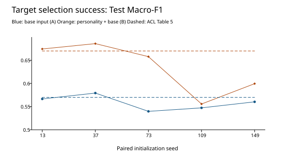

# Cultural Codes replication

Does adding giver and guesser personality information help predict whether a guesser selects an intended target? This project tests one comparison from the *Predicting Pragmatic Success* task (§4.3) in Shaikh et al. (Findings of ACL 2023). [ACL paper](https://aclanthology.org/2023.findings-acl.410/) · [Research report](docs/research_report.md)

The same pinned RoBERTa-base candidate was trained on the released splits with five paired seeds. **A** used the board words, giver rationale, target and clue. **B** prepended the released personality profiles to that same input. Each checkpoint was selected on Validation and evaluated on the same 478 Test rows. [Protocol](docs/experimental_protocol.md)

## Results

| Test metric | A · base | B · profiles + base |
| --- | ---: | ---: |
| Macro-F1, mean ± sample SD | 0.5586 ± 0.0156 | 0.6346 ± 0.0553 |
| Failure recall, mean | 0.1725 | 0.3541 |
| Success recall, mean | 0.9458 | 0.8992 |
| Accuracy, mean | 0.7695 | 0.7749 |

The paired mean Macro-F1 gain was **+0.0760 ± 0.0491** across five seeds. B detected more failed selections and missed more successful ones. The paper’s RoBERTa comparison moved from 0.57 to 0.67. The original checkpoint’s identity is unverified, and this experiment uses fixed settings. Both conditions used the same model-loading path. A reload check in the recorded environment selected SDPA attention, although the protocol specified eager attention. The reported gain describes the executed comparison on this split. The model sees the target and giver rationale, and the prefix combines several cues, which limits conclusions about human guessing, causation and generalization. [Detailed results and limitations](docs/results_analysis.md)



*Dashed lines are the published reference scores. Each point is a run. Table SDs describe variation across seeds.*

## What was verified

- A and B share all 9,519 released rows, labels and base inputs. Missing profiles, duplicates and conflicting labels were retained.
- A regression check verified that loss gives equal weight to each example in the last accumulation group, which contains 17 examples.
- The Test evaluator retained all 478 rows per run and verified the ten Validation-selected checkpoints. The prediction export supports independent score recalculation. [Validation evidence](docs/validation.md) · [Execution provenance](reports/stage5_provenance.json)

## Reproduce

From the repository root, run the following with Python 3.11 or newer. The command uses the committed predictions and standard library to verify the scores.

```text
python -B scripts/recompute_test_scores.py
```

[Prediction CSV](reports/test_predictions.csv) · [Run-level scores](reports/stage5_per_run.csv) · [Analysis guide](docs/results_analysis.md#reproduce) · [Full training replay](environment/README.md#full-training-and-evaluation-replay)

## Further reading

[Research report](docs/research_report.md) · [Methods crosswalk](docs/methods_mapping.md) · [Execution and evaluation correction](docs/stage5_training_evaluation.md) · [Data and source provenance](sources/README.md) · [Roadmap](ROADMAP.md)
