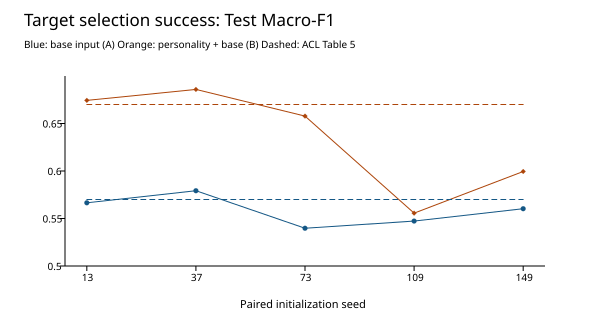

# Do personality profiles help predict whether a target is guessed?

## Abstract

This study repeats one comparison from Shaikh et al. (2023) using the released Cultural Codes data. The two conditions give a RoBERTa-base classifier either the game context alone or that same context preceded by the giver and guesser personality profiles. Across five paired seeds on the same 478 Test examples, mean Macro-F1 increased from **0.5586 ± 0.0156** to **0.6346 ± 0.0553**. The mean paired gain was **+0.0760 ± 0.0491**, with sample standard deviations across seeds. The gain mainly reflects better detection of failed selections, accompanied by lower recall for successful selections. The direction agrees with the published RoBERTa comparison. The experiment estimates the predictive contribution of the released profile prefix on this split with the recorded implementation.

## Background and research question

Pragmatic inference involves working out what a speaker intends from an utterance and its context. Common ground includes information interlocutors take to be shared. A clue in Codenames Duet can suggest different associations to different people, so Shaikh et al. collected background attributes and tested whether they helped predict gameplay actions. A personality profile describes individual traits recorded by a questionnaire. Culture and shared knowledge are broader constructs that these scores do not directly measure. The question here is whether the released profiles add predictive information for **whether a particular intended target was selected**, conditional on the same game context. [Shaikh et al., §§1, 3, 4.3–4.4](https://aclanthology.org/2023.findings-acl.410/)

## Data and task

The data come from the preprocessed `correct_guess_task` files at the pinned upstream commit. The released Train, Validation and Test splits contain **8,497**, **544** and **478** rows, respectively. Each row pairs a clue context with one intended target and a binary success label. A clue can have multiple targets and therefore multiple rows. A human guesser has the clue and board context. The model additionally receives the intended target and the giver’s rationale, so the task predicts success with information unavailable to the guesser. [Data validation](validation.md#2-data-validation) · [Source provenance](../sources/README.md)

| Condition | Released field | Input |
| --- | --- | --- |
| A | `base_text` | Remaining words, giver rationale, intended target and clue |
| B | `personality_only` | Giver and guesser profile fields followed by the exact A string |

Both fields were present in all 9,519 rows and shared the same output column. Parsing and exact string checks established that B retains the full A content. Missing profiles appear as `[None]`. The original splits, duplicate rows and conflicting labels for identical inputs were preserved. The audit found no exact input overlap between splits. Participant and game identifiers are unavailable, leaving independence at those levels unverified. [Dataset audit](../reports/dataset_validation.json)

## Methods

The classifier and fast tokenizer use `FacebookAI/roberta-base` at revision `e2da8e2f811d1448a5b465c236feacd80ffbac7b`. Each pair shares the pretrained bytes, a seeded classification head and Training row order. The five seed pairs are **13, 37, 73, 109 and 149**. False maps to 0 (failure) and True to 1 (success). [Protocol](experimental_protocol.md) · [Execution provenance](../reports/stage5_provenance.json)

| Setting | Executed value |
| --- | --- |
| Optimization | AdamW, learning rate 5e−6, linear decay to zero, zero warmup and weight decay, gradient clipping at norm 1.0 |
| Duration | 15 epochs and 3,990 optimizer updates per run |
| Batch and precision | Micro-batch 8, four-step gradient accumulation, FP32 with TF32 disabled |
| Loss | Unweighted cross-entropy summed within each micro-batch and divided by the actual example count for its accumulation group |
| Input handling | Dynamic right padding, 512 tokens including special tokens, overflow rejected before truncation |
| Selection | Highest Validation Macro-F1 across epochs, earliest epoch on an exact tie |

The frozen configuration specifies eager attention. Snapshot preparation and the GPU preflight explicitly request it. The training and final evaluation loaders omit the attention argument. Reloading the seed-13 initial snapshot in the recorded environment selected scaled dot-product attention (SDPA). Both conditions follow this loader path. The historical runs did not log the resolved backend, and the effect of enforcing eager attention on the scores is unknown. [Execution evidence](stage5_training_evaluation.md#attention-on-model-reload)

Training and evaluation kept final partial batches. All ten choices were locked before the separate Test evaluator scored the selected checkpoints. Predictions come from the larger of two logits, with exact ties assigned to class 0. Macro-F1 averages the failure and success F1 scores equally. Condition summaries use the mean and sample SD across five seeds. The paired summary applies the same calculation to the five B−A differences before rounding. The first Test evaluation attempt failed during dataset construction, before generating any predictions. The correction passed the CSV Boolean labels to the converter. All ten training runs had completed on their first attempt, and the locked checkpoint choices were used for the corrected evaluation. [Resolved GPU arguments](../reports/resolved_gpu_arguments.json) · [Evaluation correction](../reports/stage5_evaluation_correction.json)

## Results

| Test metric | A · base input | B · profiles + base |
| --- | ---: | ---: |
| Macro-F1, mean ± sample SD | 0.5586 ± 0.0156 | 0.6346 ± 0.0553 |
| Mean accuracy | 0.7695 | 0.7749 |
| Mean failure recall | 0.1725 | 0.3541 |
| Mean success recall | 0.9458 | 0.8992 |

B achieved higher Macro-F1 in all five pairs, with gains ranging from **+0.0083 to +0.1180**. The mean gain was **+0.0760 ± 0.0491**. B correctly classified an average of 38.6 of the 109 failed selections, versus 18.8 for A. It also missed more successful selections. At seed 149, total correct predictions fell by ten even as Macro-F1 rose. Every run evaluated the same 478 rows, yielding 4,780 repeated predictions. The SD describes variation across seeds on that split. [Run scores](../reports/stage5_per_run.csv) · [Paired differences](../reports/stage5_paired_differences.csv) · [Class and error analysis](results_analysis.md)

*Each point is one run. Dashed lines mark the paper’s rounded RoBERTa references, 0.57 for no priors and 0.67 for Personality. The chart shows individual seeds and has no error bars.*

The published comparison moved in the same direction, with an approximately +0.10 difference between the rounded Table 5 values. Both absolute means and the gain were lower here. The paper reports five-run averages, and the table does not give per-seed uncertainty for this comparison. [ACL publication, Table 5 and §5](https://aclanthology.org/2023.findings-acl.410/)

## Exploratory error analysis

The post hoc comparison used the **378 rows with both profiles** and the **100 rows with a missing profile**. Every seed showed a larger B−A gap in the missing group. In that group only the guesser profile was missing, so the giver profile and the missingness marker remained in B. The group contains only 24 failed selections. The subgroup comparison cannot separate missingness from differences in cases or isolate the contribution of trait values. [Exploratory results](results_analysis.md#post-hoc-exploration)

For each of three error categories, the example-selection rule picked the case that showed the transition across the most seeds. The earliest original Test row broke ties. Across all five seeds, B corrected A on *military → draft* (success), introduced an error on *examine → check* (success) and shared A’s error on *theater → opera* (failure). These cases show changes in predictions. The saved outcomes do not identify the features that drove a decision. [Case selection and predictions](results_analysis.md#post-hoc-exploration)

## Discussion and limitations

With the recorded model and implementation, adding the profile prefix improved prediction on the released Test split, mainly by identifying more failed selections. It changes numerical traits, role markers, missingness indicators and input length together. This design cannot assign credit to individual traits or establish a causal personality effect, a human inference mechanism or generalization to new participants or populations.

The original checkpoint’s identity is unresolved. The paper searched learning rates and epoch settings, while this study fixed both before the ten runs. The released script names `roberta-base-cased`, sets 25 epochs and enables incomplete-batch dropping. The execution here uses a pinned candidate, 15 epochs and full row retention. Original software and exact run settings remain incompletely specified. The release also lacks participant and game IDs, raw guesses and the personality scoring pipeline, leaving split independence, label reconstruction and score construction unverified. [Methods crosswalk](methods_mapping.md) · [Original source snapshot](../sources/README.md)

## Reproducibility

From the repository root, run `python -B scripts/recompute_test_scores.py` with Python 3.11 or newer. The committed prediction export and reference reports are sufficient to check per-run Macro-F1 and accuracy, confusion matrices, condition averages, sample SDs and paired differences. The command also passed in a temporary directory containing only the seven required public files. Using the original local run artifacts, the detailed analysis regenerated the class CSV, analysis JSON and seed figure. All three matched the Windows working copies byte for byte and the Git blobs after newline normalization. [Prediction export](../reports/test_predictions.csv) · [Detailed analysis commands](results_analysis.md#reproduce)

A new training run needs the pinned data, tokenizer and pretrained weights plus the recorded Windows CUDA environment. The runbook documents setup, validation, paired initialization, training, locked Test evaluation and analysis in a separate checkout. A separate local checkout passed hash verification for 16 source files and five tokenizer files using locally retained inputs. Installation and the complete training replay on a fresh machine remain unverified. Re-evaluating the exact original selected models additionally requires the retained checkpoint weights and provenance, which sit outside Git. Re-execution can differ in model bytes and metrics across environments. [Training replay runbook](../environment/README.md#full-training-and-evaluation-replay)

## Technical decisions and lessons

- **Verify the input contrast.** Exact suffix equality and shared labels make comparisons interpretable as the addition of the released prefix to the same base input.
- **Weight by examples across accumulated batches.** Averaging micro-batch means over-weighted the single example in the final `[8, 8, 1]` accumulation group. A regression check verified the corrected denominator of 17.
- **Retain every evaluation case.** Keeping the last incomplete batch protects class support and ensures that scores use all 478 examples.
- **Isolate selection from final scoring.** Validation selects each checkpoint. The Test path checks the ten locked selections and records each row’s prediction.
- **Use complementary metrics.** Macro-F1 highlights changes in performance for the smaller failure class. Accuracy tracks all correct cases and shows the smaller net change.

AI tools supported coding, documentation, and verification.

## References

- Shaikh, O., Ziems, C., Held, W., Pariani, A., Morstatter, F., and Yang, D. (2023). *Modeling Cross-Cultural Pragmatic Inference with Codenames Duet*. Findings of ACL 2023, 6550–6569. [ACL Anthology](https://aclanthology.org/2023.findings-acl.410/)
- SALT-NLP. *Codenames Duet* dataset and code at commit `9bf4550e681f7a42ac406439b00b0c717f59f13c`. [Pinned repository](https://github.com/SALT-NLP/codenames/tree/9bf4550e681f7a42ac406439b00b0c717f59f13c)
- FacebookAI. *RoBERTa base* model and tokenizer. [Pinned revision](https://huggingface.co/FacebookAI/roberta-base/tree/e2da8e2f811d1448a5b465c236feacd80ffbac7b)
- Interfaces used in the implementation. [Transformers Trainer 4.57.1](https://huggingface.co/docs/transformers/v4.57.1/en/main_classes/trainer) · [PyTorch AdamW 2.9](https://docs.pytorch.org/docs/2.9/generated/torch.optim.AdamW.html) · [scikit-learn F1 1.7](https://scikit-learn.org/1.7/modules/generated/sklearn.metrics.f1_score.html)
