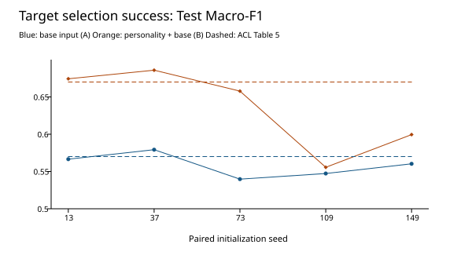

# What changed when the model received personality profiles?

On the same 478 released Test cases, adding the giver and guesser profile prefix increased mean Macro-F1 from **0.5586 to 0.6346**. The mean within-seed gain was **0.0760** (sample SD 0.0491). Most of the gain came from detecting more failed target selections. The classifier also mislabeled more successful selections as failures. Accuracy consequently changed much less, from 0.7695 to 0.7749.



## Prediction and checkpoint integrity

The row-level check matched all ten original prediction files to the released Test CSV using the split hash, one-based row, stable case ID, source export index, input hash and reference label. All 4,780 decisions also matched the public prediction export in order. False (0) means failure to select the intended target and True (1) means success. The maximum of two finite logits determined the prediction, with class 0 selected on an exact tie. The saved logits contained no exact ties. Both classes enter Macro-F1 with equal weight and undefined precision is set to zero. Recalculated confusion counts, class metrics, accuracy, seed means, sample SDs and paired differences agreed with the stored results within an absolute tolerance of 1e−12. Differences and sample SDs use unrounded run scores. For example, the displayed scores at seed 37 give 0.6859 − 0.5792 = 0.1067, while the unrounded paired difference rounds to 0.1066.

The final Trainer states recorded 15 epochs and 3,990 updates for all ten runs. Each selected checkpoint matched the earliest maximum among its 15 Validation scores, the locked weight hash and the final evaluation record. All ten fits had one start and one completion with no resume checkpoint.

The original evaluation traceback ended at dataset construction. The correction preflight recorded ten locked selections and zero prediction files. The source diff and both recorded hashes identify one changed argument. The corrected evaluator passes the raw CSV Boolean strings to the dataset converter and loads the locked selections. [Correction record](../reports/stage5_evaluation_correction.json) · [Provenance](../reports/stage5_provenance.json)

## Class performance

Each cell summarizes five run-level values as mean ± sample SD. Each confusion matrix in the JSON has **actual classes in rows, predicted classes in columns**, both ordered False, True. The CSV contains both classes' precision, recall, F1, support and predicted counts for each run. [Run metrics](../reports/results_by_class.csv) · [Matrices and summaries](../reports/results_analysis.json)

| Metric | A · base | B · profiles + base |
| --- | --- | --- |
| Predicted failures (count) | 38.8000 ± 5.3104 | 75.8000 ± 21.8335 |
| Failure precision | 0.4842 ± 0.0250 | 0.5030 ± 0.0605 |
| Failure recall | 0.1725 ± 0.0263 | 0.3541 ± 0.1215 |
| Failure F1 | 0.2536 ± 0.0307 | 0.4088 ± 0.1053 |
| Success precision | 0.7947 ± 0.0043 | 0.8259 ± 0.0236 |
| Success recall | 0.9458 ± 0.0077 | 0.8992 ± 0.0275 |
| Success F1 | 0.8636 ± 0.0027 | 0.8605 ± 0.0107 |
| Accuracy | 0.7695 ± 0.0043 | 0.7749 ± 0.0186 |
| Macro-F1 | 0.5586 ± 0.0156 | 0.6346 ± 0.0553 |

Of the 109 actual failures, A detected 18.8 and B detected 38.6 on average. Of the 369 successes, A correctly predicted 349.0 and B correctly predicted 331.8. The change in failure F1 (+0.1552) and success F1 (−0.0032) contribute equally to the Macro-F1 difference. An always-True prediction on these same labels gets accuracy 0.7720 and Macro-F1 0.4357. This descriptive imbalance reference was calculated after evaluation.

## Seed variation and paired errors

Each epoch and Validation score below belongs to the checkpoint selected during training. Each Test score is from its single final evaluation.

| Seed | A epoch | A Val | A Test | B epoch | B Val | B Test | B − A |
| --- | --- | --- | --- | --- | --- | --- | --- |
| 13 | 12 | 0.5917 | 0.5665 | 4 | 0.6774 | 0.6743 | 0.1078 |
| 37 | 6 | 0.5530 | 0.5792 | 8 | 0.6969 | 0.6859 | 0.1066 |
| 73 | 10 | 0.5847 | 0.5397 | 14 | 0.6975 | 0.6578 | 0.1180 |
| 109 | 13 | 0.5706 | 0.5473 | 6 | 0.6288 | 0.5556 | 0.0083 |
| 149 | 7 | 0.5733 | 0.5603 | 6 | 0.6578 | 0.5995 | 0.0392 |

Each row of the next table partitions the same 478 cases. The last two columns give the net change in correct predictions within each true class.

| Seed | Both correct | A only correct | B only correct | Both wrong | Δ correct False | Δ correct True |
| --- | --- | --- | --- | --- | --- | --- |
| 13 | 316 | 50 | 56 | 56 | 30 | -24 |
| 37 | 336 | 35 | 43 | 64 | 28 | -20 |
| 73 | 336 | 32 | 42 | 68 | 25 | -15 |
| 109 | 340 | 26 | 25 | 87 | 2 | -3 |
| 149 | 327 | 41 | 31 | 79 | 14 | -24 |

At seeds 13, 37 and 73, B gained 25–30 correct failure predictions and lost 15–24 correct success predictions. At seed 109, B gained only two failures and lost three successes. At seed 149 it gained 14 failures but lost 24 successes. In both latter runs the total correct count fell while the two-class Macro-F1 rose. B predicted failure 99, 90, 71, 42 and 77 times in seed order. At 149, B's 77 failure calls included 44 false alarms. At 109, its 42 failure calls were fewer than in any other B run.

Across seeds, A changed its prediction on **64/478** cases at least once and B on **108/478**. Test Macro-F1 SD was 0.0156 for A and 0.0553 for B. The saved Validation curves start at 0.4322 in all ten runs. B selected epoch 6 for both 109 and 149, with Validation scores of 0.6288 and 0.6578, respectively. Their final-epoch Validation scores were 0.6019 and 0.5793. These logs locate the selected epochs and quantify variation. They cannot identify which optimization dynamics produced the Test errors or establish overfitting. The five fits reuse one Test set, so uncertainty about new cases or new participants remains open.

## Post hoc exploration

Both profiles were present for 378 cases (85 False, 293 True). At least one profile was missing for 100 cases (24 False, 76 True). In this Test split all missing profiles belonged to the guesser. The table reports Macro-F1 within each group, computed separately for each seed.

| Seed | Available A | Available B | B − A | Missing A | Missing B | B − A |
| --- | --- | --- | --- | --- | --- | --- |
| 13 | 0.5818 | 0.6622 | 0.0803 | 0.5101 | 0.7177 | 0.2076 |
| 37 | 0.5905 | 0.6507 | 0.0602 | 0.5393 | 0.7768 | 0.2375 |
| 73 | 0.5501 | 0.6214 | 0.0712 | 0.5039 | 0.7636 | 0.2597 |
| 109 | 0.5618 | 0.5662 | 0.0044 | 0.4978 | 0.5164 | 0.0185 |
| 149 | 0.5662 | 0.5904 | 0.0243 | 0.5393 | 0.6337 | 0.0944 |

The gain was larger in the missing group at all five seeds. Only 24 failures contribute to that group's failure recall. The groups contain different examples and the missing group still carries the giver profile and an explicit missing marker. This comparison cannot isolate the effect of missingness or the contribution of the numerical trait values.

The post hoc selection rule favors persistent patterns. Within each error category, it takes the case exhibiting that outcome across the most seeds and breaks ties by the earliest original Test row. The words below are from the released input. Predictions are in seed order 13, 37, 73, 109, 149.

| Category | Test row | Clue → target | Label | A predictions | B predictions |
| --- | --- | --- | --- | --- | --- |
| B_only | 66 | military → draft | 1 | 0 0 0 0 0 | 1 1 1 1 1 |
| A_only | 34 | examine → check | 1 | 1 1 1 1 1 | 0 0 0 0 0 |
| both_wrong | 5 | theater → opera | 0 | 1 1 1 1 1 | 1 1 1 1 1 |

For *military → draft*, the prefix accompanied a change from failure to success predictions across all five seeds. For *examine → check*, the change went the other way despite a success label. Both inputs predicted success for *theater → opera*, which has a failure label. These examples illustrate the three outcomes. The released rows provide no direct evidence about the guesser's thoughts or which input tokens determined a model decision.

## Published comparison and scope

The ACL publication's Table 5 reports RoBERTa Macro-F1 of 0.57 with no priors and 0.67 with Personality, an approximately 0.10 gain from rounded scores. This replication recovered the positive direction for each paired seed. Its absolute means were about 0.011 and 0.035 below the published values, and its mean gain about 0.024 smaller. The paper averages five runs and gives no per-run scores or dispersion for these two cells. The available figures support a descriptive comparison only. [ACL publication, §4.3, §5, Table 5 and Appendix E](../sources/paper/2023.findings-acl.410.pdf)

The experiment retains the released splits and the target-level binary task. The classifier sees the target and giver rationale alongside the clue and remaining words, giving it information hidden from the human guesser. The public script names roberta-base-cased. This project used pinned FacebookAI/roberta-base, fixed 5e−6 and 15 epochs, and preserved incomplete batches. The paper searched rates and epoch settings, and the released classification code specifies 25 epochs and drops incomplete batches. Exact checkpoint identity, original seeds and software environment remain unresolved. Participant/game identifiers, original guesses and the personality-scoring pipeline are unavailable for independent reconstruction. [Methods crosswalk](methods_mapping.md) · [Released training code](../sources/upstream/models/baseline_classification.py)

Under this dataset, candidate model and protocol, the full profile prefix improved average prediction of target selection success, especially the representation of failures in the score. Trait values, missing markers, role labels and input length change together. These runs cannot separate their contributions or establish a causal effect of personality, a cognitive mechanism, statistical significance or generalization to new populations.

## Reproduce

The committed [Test predictions](../reports/test_predictions.csv) contain the condition, seed, one-based Test row, reference label and predicted label. From the project root, run `python -B scripts/recompute_test_scores.py` with Python 3.11 or newer. The standard-library check prints the run and prediction counts and verifies per-run Macro-F1, accuracy, confusion matrices, condition summaries and the mean paired difference of 0.0760009616 against the retained reports.

The full check also uses the hash-verified Test CSV, original run artifacts and project Python 3.11.17 environment at `.venv-gpu`. With ReportLab 4.4.9 available in a separate interpreter, run the following from the project root in PowerShell. The two interpreters keep the exact GPU lock separate from plotting dependencies.

```powershell
python -m venv .venv-report
.\.venv-report\Scripts\python.exe -m pip install 'reportlab==4.4.9'
$out = Join-Path ([System.IO.Path]::GetTempPath()) ('cultural-codes-analysis-' + [guid]::NewGuid().ToString('N'))
.\.venv-report\Scripts\python.exe -B scripts/analyze_results.py --output-dir $out
```

This writes `results_analysis.json`, `results_by_class.csv` and `paired_macro_f1.svg` into the chosen temporary folder. The JSON includes the 150 Validation observations, paired error transitions and prediction vote counts. All three regenerated files matched the Windows working copies byte for byte. Comparison with the raw Git blobs required normalizing CRLF to LF. The detailed command rechecks saved outputs and checkpoint hashes without running model inference. [Full training replay](../environment/README.md#full-training-and-evaluation-replay)
